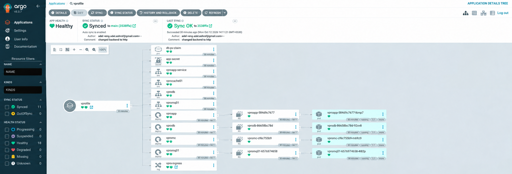
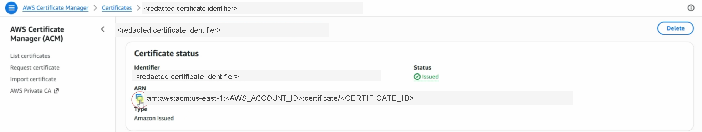

# Production Platform — vProfile Helm GitOps Configuration

This repository describes the desired Kubernetes state for the **vProfile** application. It contains a Helm chart, a set of plain Kubernetes manifests, and Argo CD project/application definitions. It is the GitOps configuration repository in a wider delivery platform: application code is built elsewhere, while this repository specifies the image and Kubernetes configuration that should run.

> **Important:** the current Argo CD `Application` points to `helm/vprofile-chart`, but the chart checked into this repository is at `helm/vprofile`. It also names a different GitHub owner from the configured `origin` remote. Argo CD cannot render the checked-in chart with that path as written. See [Argo CD integration](#argo-cd-integration) and resolve this before relying on automated synchronization.

## Project overview

The intended delivery boundary is:

```text
Application repository / CI
  build and scan image → publish image → commit selected image tag here
                                             ↓
Git repository (this repository) → Argo CD → Amazon EKS / Kubernetes
```

The application pipeline is responsible for source code, builds, scanning, image publishing, and—if implemented there—committing an updated tag. Argo CD is responsible for comparing Git's desired state with the destination cluster and applying the rendered manifests. This repository owns neither an image build workflow nor AWS infrastructure provisioning; no CI workflow is present here to verify automated tag updates.

## GitOps architecture


*Architecture supplied with this project. It describes the intended wider platform; the checked-in files in this repository are the authoritative source for the configuration documented below.*

At a high level, an application image can be published to Amazon ECR (or another registry) and its immutable tag recorded in `helm/vprofile/values.yaml`. Argo CD watches the configured Git source and renders the Helm chart into Kubernetes objects for EKS. The application service is exposed through an Ingress, which is configured for the AWS Load Balancer Controller. DNS, EKS, ECR, the controller, and an ACM certificate are external prerequisites; this repository does not provision them.

## Repository structure

```text
.
├── argocd/
│   ├── apps/vprofile-app.yaml          # Argo CD Application
│   └── projects/vprofile-project.yaml  # Argo CD AppProject scope
├── helm/
│   └── vprofile/
│       ├── Chart.yaml                  # Chart metadata (v0.1.0)
│       ├── values.yaml                 # Images, replicas, storage, ingress, secrets
│       └── templates/
│           ├── app-deployment.yaml
│           ├── db-deployment.yaml
│           ├── dockerregistry-secret.yaml
│           ├── ingress.yaml
│           ├── mc-deployment.yaml
│           ├── pvc.yaml
│           ├── rmq-deployment.yaml
│           ├── secret.yaml
│           └── services.yaml
├── kubedefs/                            # Stand-alone, non-Helm manifests
├── assets/                              # Documentation images
└── README.md
```

`kubedefs/` contains a separate, hand-written variant of the vProfile resources. It is not referenced by the Argo CD `Application` and should not be assumed to be deployed by it. It differs from the Helm chart (for example, it uses an NGINX Ingress); choose one deployment method deliberately to avoid duplicate resources.

## Helm chart overview

`helm/vprofile/Chart.yaml` declares an application chart named `vprofile` with chart version `0.1.0` and application version `1.0.0`. The files under `templates/` are parameterized Kubernetes manifests. Helm resolves expressions such as `{{ .Values.app.replicas }}` from `values.yaml` to produce the final resources that Kubernetes receives.

The chart produces the following resources when ingress is enabled and the registry secret remains disabled (the current defaults):

| Kind | Names | Purpose |
| --- | --- | --- |
| Deployment | `vproapp`, `vprodb`, `vpromc`, `vpromq01` | Application, database, Memcached, and RabbitMQ workloads |
| Service | `vproapp-service`, `vprodb`, `vprocache01`, `vpromq01` | Cluster-internal service discovery and ports |
| PersistentVolumeClaim | `db-pv-claim` | MySQL data storage request |
| Secret | `app-secret` | Database and RabbitMQ password values used by workloads |
| Ingress | `vpro-ingress` | ALB-facing HTTP/HTTPS routing to `vproapp-service` |
| Secret (conditional) | `docker-registry-secret` | Image pull credentials when `dockerregistry.enabled=true` |

The application deployment waits for the database and Memcached service DNS names before starting. The database mounts `db-pv-claim` at `/var/lib/mysql`; its root password and RabbitMQ's default password come from `app-secret`.

## Configuration with `values.yaml`

| Value | Current purpose / default |
| --- | --- |
| `app.image`, `app.tag` | Application image and tag; currently `vprocontainers/vprofileapp:latest` |
| `app.replicas`, `app.containerPort`, `app.servicePort` | Application scale and port mapping (1, 8080, 8080) |
| `db.*` | Database image, one replica, port 3306, `gp2` StorageClass, and 3 GiB PVC request |
| `memcached.*`, `rabbitmq.*` | Supporting image, one replica, and service port configuration |
| `ingress.enabled`, `ingress.host`, `ingress.servicePort` | Enables ingress and routes `vprofile.example.com` to port 8080 |
| `secrets.*` | Values rendered into `app-secret`; do not store production credentials in Git |
| `dockerregistry.*` | Optionally renders and uses a `kubernetes.io/dockerconfigjson` pull secret |

For an environment-specific deployment, use a private values file or an approved secret-management integration rather than adding credentials to Git. When a separate application repository updates the chosen image, it should change `app.image` and preferably an immutable `app.tag` in the Git source that Argo CD actually watches. This repository contains no workflow proving that such a commit is automated.

## Kubernetes resources and traffic flow

```text
Internet → ALB → vpro-ingress → vproapp-service → vproapp Pod
                                           ↘
                              vprodb / vprocache01 / vpromq01 Services
```

All four Services are `ClusterIP`, so they are not directly public. The Ingress selects `vproapp-service`; the app reaches the database and Memcached by Kubernetes DNS. The PVC requests `ReadWriteOnce` storage through the configured `gp2` StorageClass. Each Deployment is configured with one replica by default. No CPU/memory requests or limits, readiness/liveness probes, pod disruption budgets, affinity rules, or high-availability settings are defined by this chart.

## Argo CD integration

`argocd/projects/vprofile-project.yaml` defines the `vprofile` AppProject in the `argocd` namespace. It allows source `git@github.com:devops4sure/vprofile-helm.git`, destination namespace `vprofile` on `https://kubernetes.default.svc`, cluster-scoped `Namespace`, and all namespaced resource kinds.

`argocd/apps/vprofile-app.yaml` defines application `vprofile` in `argocd` and requests:

| Setting | Manifest value |
| --- | --- |
| Project | `vprofile` |
| Source repository | `git@github.com:devops4sure/vprofile-helm.git` |
| Revision | `main` |
| Declared chart path | `helm/vprofile-chart` **(does not exist in this checkout)** |
| Destination | In-cluster API, namespace `vprofile` |
| Sync | Automated with pruning, self-healing, namespace creation, and server-side apply |

The current checkout's `origin` is `https://github.com/7azeeem/vprofile-helm.git`, which is also different from the application manifest source. Before creating or syncing the Argo CD application, verify the intended repository and make the manifest's source/path match the actual chart location. Once those references resolve and Argo CD has repository access, a Git revision change can be detected and synchronized automatically. Pruning and self-healing are explicitly enabled, so Argo CD may remove resources absent from the desired state and reconcile detected drift within its permissions.

## Argo CD Application resource tree



*Captured point-in-time resource tree supplied with this project; it is not a live status indicator.*

The image illustrates the normal ownership chain: Deployments create ReplicaSets, ReplicaSets create Pods, and Services select the workload Pods. It also shows the PVC, application secret, and ingress alongside the vProfile application resources. The screenshot's names and layout are broadly consistent with the chart, but the displayed health and synchronization state must not be treated as the current cluster status.

## Ingress, TLS, and AWS Certificate Manager

The Helm Ingress uses `ingressClassName: alb` and these AWS Load Balancer Controller annotations:

- Internet-facing ALB and IP target mode
- HTTP (80) and HTTPS (443) listeners
- Redirect to HTTPS on 443
- HTTP protocol from the ALB to the application backend
- An ACM certificate ARN, currently embedded directly in `templates/ingress.yaml`



*Sanitized supporting screenshot. Account and certificate identifiers were redacted.*

The chart currently implements HTTPS-oriented ALB configuration, but the certificate ARN is hard-coded in the template rather than configured through `values.yaml`. Treat it as environment-specific configuration and replace it with a valid ARN for the target AWS account/region before deployment; documentation examples use `<ACM_CERTIFICATE_ARN>`. The certificate must cover `ingress.host` and, for ALB integration, exist in the same AWS region as the load balancer. This repository does not create certificates, DNS records, an ALB, or the AWS Load Balancer Controller.

## Deployment and synchronization workflow

These are local render/inspection commands; they do not deploy to a cluster.

```powershell
helm lint .\helm\vprofile
helm template vprofile .\helm\vprofile --namespace vprofile
helm template vprofile .\helm\vprofile --namespace vprofile | Select-String '^(kind:|  name:)'
```

After correcting and applying the Argo CD manifests in an environment with an Argo CD CLI context, inspect the declared application and target workloads:

```powershell
argocd app get vprofile
kubectl get deployment,service,pvc,ingress -n vprofile
kubectl get pods -n vprofile
kubectl describe ingress vpro-ingress -n vprofile
```

`helm` and `kubectl` were not available in the inspected working environment, so these commands are documented but were not executed here.

## Prerequisites

Required to render and operate this configuration:

- Git and Helm 3 for source control and local validation.
- Access to the intended Kubernetes/EKS cluster and `kubectl` credentials for cluster inspection.
- Argo CD installed in the `argocd` namespace, with permission and repository credentials for the selected Git source.
- A storage provisioner and a `gp2` StorageClass (or an overridden `db.storageClass`) for the database PVC.

Required for the configured Ingress:

- AWS Load Balancer Controller installed and authorized in the cluster.
- A valid `alb` IngressClass and AWS networking/IAM prerequisites.
- DNS for the selected hostname.
- An issued ACM certificate in the ALB's AWS region for HTTPS.

Optional: image-pull credentials if the selected registry is private; configure them through a secure values/secret process rather than committing credentials.

## CI/CD and GitOps integration

The intended handoff is a commit that selects a new container image tag in the Helm values consumed by Argo CD. A secure application pipeline should build, test, scan, and publish an image, then create a reviewable Git change in this repository. Argo CD then renders that committed state and applies it to the permitted destination. Neither ECR publishing nor image-tag update automation exists in the files inspected here, so their implementation and authorization must be confirmed in the separate application repository.

## Security considerations

Implemented configuration:

- Workload passwords are injected by Kubernetes Secret references rather than direct container environment literals.
- A pull secret can be used when the conditional registry-secret template is enabled.
- The Ingress requests HTTPS listener/redirect behavior via ALB annotations.

Items needing attention:

- Default secret values are stored in `values.yaml`; replace them with a secure delivery mechanism before production use.
- The certificate ARN is hard-coded in the template, including account-specific information; make it environment-specific.
- Images use `latest` by default. Use immutable, scanned image tags for traceability and predictable rollbacks.
- No resource limits/requests, workload probes, NetworkPolicies, custom service accounts, RBAC bindings, or external secret manager configuration are present. Add them only after designing them for the target environment.

## Troubleshooting

| Symptom | Check |
| --- | --- |
| Helm render/lint failure | Run the local Helm commands above and confirm values keys and YAML syntax. |
| Argo CD `OutOfSync` or comparison error | Check `argocd app get vprofile`; first verify the repository URL and missing `helm/vprofile-chart` path issue. |
| Image pull failure | Inspect `kubectl describe pod <pod> -n vprofile`; verify image/tag, registry access, and any pull secret. |
| Pods do not become Ready | Inspect logs/events with `kubectl logs` and `kubectl describe pod`; verify database, Memcached, RabbitMQ, secrets, and service DNS. |
| PVC remains Pending | Inspect `kubectl describe pvc db-pv-claim -n vprofile`; verify the `gp2` StorageClass and provisioner. |
| No ALB / ingress address | Inspect `kubectl describe ingress vpro-ingress -n vprofile` and AWS Load Balancer Controller logs; verify controller IAM, subnets, class, and annotations. |
| TLS/certificate error | Verify `<ACM_CERTIFICATE_ARN>` identifies an issued regional certificate covering the configured hostname. |

## Related repositories

The checked-out Git remote is [7azeeem/vprofile-helm](https://github.com/7azeeem/vprofile-helm). No Infrastructure or Application repository URL is defined in the inspected files, so none is linked here.

## License

No license file or license declaration is present in this repository.
